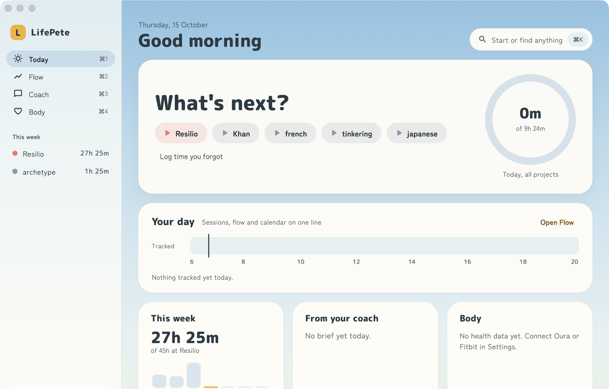

<p align="center">
  
</p>

<h1 align="center">LifePete</h1>

<p align="center">
  <strong>Time tracking that knows when you're in flow.</strong><br>
  On your desk, in your browser, in your editor and in your pocket.
</p>

<p align="center">
  <a href="https://lifepete.com"></a>
  <a href="https://github.com/lanterno/beats/releases/latest"></a>
  <a href="https://github.com/lanterno/beats/actions/workflows/api.yml"></a>
  <a href="https://github.com/lanterno/beats/actions/workflows/ui.yml"></a>
  <a href="LICENSE"></a>
</p>

<p align="center">
  
</p>

LifePete (the codebase is called **Beats**) gives you one place for the hours you
put in. Start a timer with one click, or let the daemon notice that you've been
deep in a repo for twenty minutes and offer to start one for you. At the end of
the week you know where the time went, whether the day job's hours add up, and
when you do your best work.

## Two ways to use it

- **Hosted, at [lifepete.com](https://lifepete.com).** Sign in with a passkey and start
  a timer; there is nothing to install or run. The Mac and phone apps, the daemon and the
  VS Code extension pair with your account from Settings. It runs this repository's
  `main`, and using it is what keeps the project going.
- **Self-hosted.** Everything lifepete.com runs is here, under MIT. One
  `docker compose` file brings up the database, the API and the web app on a single port;
  see [Deployment](#deployment).

## Highlights

- **One-click timers, weekly goals.** Per-project targets and caps, a ring for today,
  and a week that tells you what the rest of it needs.
- **Day-job contracts.** Hours as a percentage of full time, your region's public
  holidays, absences, and a running overtime balance you can trust.
- **Flow Score.** A local daemon measures how focused a session is, from the active
  app, idle time and context switches. Raw content never leaves your machine.
- **Auto-timer and distraction shield.** It suggests a timer when you're clearly
  working, and gives you a nudge when you drift during one.
- **An AI coach.** A morning brief and a chat that know your week, your flow and your
  recovery.
- **Body data.** Fitbit, Oura, HealthKit and Health Connect, with sleep set beside the
  next day's flow, plus chronotype detection.
- **Insights.** Contribution heatmap, daily rhythm, streaks, tags derived from flow
  signals, monthly retrospectives and a year in review.
- **Painted, not plain.** Two hours, afternoon and dusk: a sky over green hills
  behind every screen, in three densities.
- **Yours to keep.** Passkey sign-in, full JSON backup and restore, CSV export,
  webhooks, and a privacy dashboard to audit and delete signals.

## Everywhere you work

| Surface | What it does |
|---------|--------------|
| **Web app** ([`ui/`](ui/)) | The full experience: projects, contracts, insights, coach, settings. Installable as a PWA, with an offline timer. |
| **Desktop app** ([`companion/`](companion/)) | A native Mac window and menu bar item: the timer, flow, coach and body. Quick start from any app (⌃⌥T), a focus mode, and logging time you forgot. Also builds for iOS and Android, where it bridges HealthKit and Health Connect. |
| **Daemon** ([`daemon/`](daemon/)) | `beatsd`, which runs in the background on macOS and Linux to compute the Flow Score, plus a CLI to query it from the terminal. |
| **VS Code** ([`integrations/vscode-beats/`](integrations/vscode-beats/)) | Tags flow windows with your repo, branch and language, and shows the live flow score in the status bar. |
| **Wall clock** ([`wall-clock/`](wall-clock/)) | An ESP32 with LEDs and an e-ink display that shows the day's progress on the wall. |

## How it fits together

```
                            ┌─────────────┐
                            │  FastAPI    │ ◄────► MongoDB
                            │  (Python)   │
                            └──────┬──────┘
            ┌──────────────────────┼──────────────────────┐
            │             ┌────────┼────────┐             │
     ┌──────┴──────┐ ┌────┴────┐ ┌─┴──────┐ ┌─────────┐ ┌─┴────────┐
     │  React UI   │ │ Flutter │ │ beatsd │ │ VS Code │ │  ESP32   │
     │  (Vite/TS)  │ │  app    │ │ daemon │ │  ext    │ │  clock   │
     └─────────────┘ └─────────┘ └───┬────┘ └────┬────┘ └──────────┘
                                     │           │
                                     └─heartbeat─┘
```

| Component | Stack |
|-----------|-------|
| **API** | Python 3.14, FastAPI, PyMongo (async MongoDB), Pydantic v2 |
| **UI** | React 19, TypeScript, Vite, TanStack Query, Tailwind CSS v4 |
| **Daemon** | Go, macOS/Linux signal collection, Flow Score engine |
| **Companion** | Flutter (macOS, iOS, Android, Linux, Windows) |
| **VS Code extension** | TypeScript |
| **Wall clock** | ESP32 firmware (Arduino/C++), WS2812B LEDs and an e-ink display |
| **Infrastructure** | Docker Compose for self-hosting; Cloud Run and Firebase Hosting on Google Cloud (Terraform) |

## Getting started

```bash
# API: needs Docker, because testcontainers starts MongoDB for you
cd api && uv run --group dev pytest src/ -v
cd api && just run-locally          # uvicorn on :7999

# Web app
cd ui && pnpm install && pnpm dev   # Vite dev server on :8080

# Desktop app
cd companion && flutter run -d macos --dart-define-from-file=config/local.json
```

A [devcontainer](.devcontainer/devcontainer.json) is included for VS Code and GitHub
Codespaces, with every dependency pre-installed.

### The daemon

```bash
beatsd pair <code>            # pair it with your account
beatsd run --dry-run          # see what it would send
beatsd run

beatsd status                 # paired? running? API reachable? today's flow
beatsd recent --here          # the last hour of flow in this repo
beatsd top --here --json      # top repos, languages and apps, ready for jq
beatsd open --here            # open Insights filtered to this repo
```

Every read-side command takes `--json`, and `--here` stands for the current git repo.
[daemon/README.md](daemon/README.md) has the full reference.

## Repository layout

```
api/                          Python API (FastAPI + MongoDB)
ui/                           React SPA (Vite + TypeScript)
companion/                    Flutter desktop and mobile app
daemon/                       Go daemon: signal collection + Flow Score
integrations/vscode-beats/    VS Code extension
wall-clock/                   ESP32 firmware
shared/                       Data shared across surfaces: app labels, brand name, logo
scripts/                      Codegen that stamps shared/ into each surface
compose.selfhost.yml          Self-hosted stack (Mongo + API + SPA on one port)
justfile                      Stack verbs (build, up, health, logs, backup) and the test sweep
terraform/                    Google Cloud infrastructure (lifepete.com)
docs/                         Design notes
```

## Testing and code quality

```bash
cd api && uv run --group dev pytest src/          # unit + HTTP contract, against real MongoDB
cd ui && pnpm test                                # Vitest
cd ui && pnpm e2e                                 # Playwright (needs the API running)
cd daemon && go test ./...
cd companion && flutter analyze && flutter test
cd integrations/vscode-beats && npm test
```

[Lefthook](lefthook.yml) runs linters and type checks on every commit (Ruff, ty, Biome,
gofmt, `flutter analyze`) and the full test suites on every push. GitHub Actions runs
the same checks on every pull request.

## Deployment

**Self-hosted.** `compose.selfhost.yml` runs MongoDB, the API, and an nginx that serves
the SPA and proxies `/api`, all on one port (`http://localhost:6008`). Copy
`api/.env.example` to `api/.env` and set its secrets, then name the database password
and the host the browser sees; the stack refuses to start without them:

```bash
export BEATS_DB_PASSWORD=<a long random string>
export BEATS_RP_ID=localhost BEATS_ORIGIN=http://localhost:6008
just build          # build the images
just up-detached    # start Mongo, the API and the SPA
just health         # check the API through the same nginx a browser uses
just logs           # follow all three
just backup <dir>   # mongodump into <dir>
```

**lifepete.com** runs on Google Cloud: the API on Cloud Run, built by Cloud Build with
Terraform owning its config, and the SPA on Firebase Hosting, shipped from
`.github/workflows/ui.yml`. That splits the SPA and API across two origins joined by
CORS, which nothing local resembles. Read Infrastructure in [CLAUDE.md](CLAUDE.md)
before removing anything that looks like dead config.

## Design notes

Open work — bugs, follow-ups, open questions — is tracked in
[Linear](https://linear.app/elghareeb/project/lifepete-a8ecce3a86de). These documents hold the decisions and designs.

| Document | What it covers |
|----------|----------------|
| [Work Contracts](docs/work-contracts.md) | Day-job contracts: percentage of full time, regional holidays, absences, the overtime balance |
| [Project Page](docs/project-page.md) | The project page built around where you stand, the week ledger behind it, and the afternoon and dusk theme |
| [Architecture](ARCHITECTURE.md) | How the API, the web app and the wall clock are put together |
| [Companion](companion/README.md) | The Flutter companion: what it does on a Mac and a phone, its architecture, pairing and the API |
| [Daemon](daemon/README.md) | `beatsd`: the flow score, the auto-timer, and its CLI |
| [Homebrew formula](integrations/homebrew-formula/README.md) | Publishing `brew install lanterno/beats/beatsd` |

## Community

- **Questions and ideas** go to [Discussions](https://github.com/lanterno/beats/discussions),
  **bugs** to [issues](https://github.com/lanterno/beats/issues/new/choose), and
  **vulnerabilities**, privately, as [SECURITY.md](SECURITY.md) says.
- **Contributing:** [CONTRIBUTING.md](CONTRIBUTING.md) covers where to start, the hooks
  and how commits are split. Everyone is expected to follow the
  [code of conduct](CODE_OF_CONDUCT.md).
- **Help with your lifepete.com account:** [SUPPORT.md](.github/SUPPORT.md).
- **Supporting the project:** use [lifepete.com](https://lifepete.com), or sponsor it on
  [GitHub Sponsors](https://github.com/sponsors/lanterno) or [Ko-fi](https://ko-fi.com/lanterno).

## License

MIT. See [LICENSE](LICENSE).
